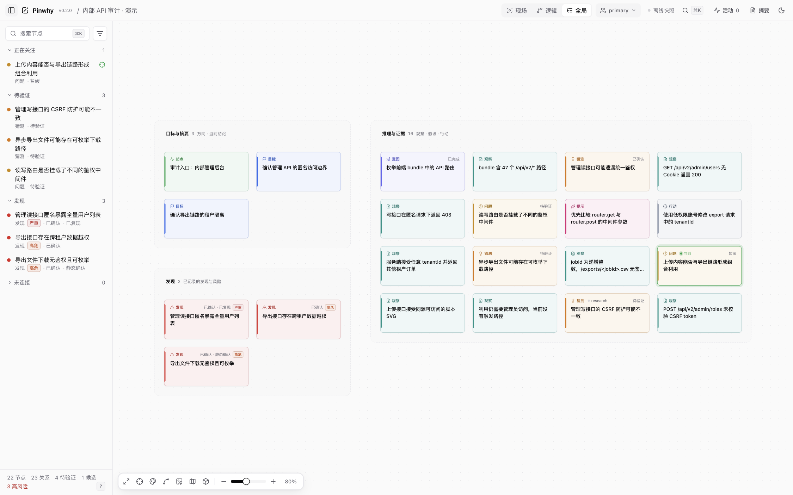

<p align="center">
  <picture>
    <source media="(prefers-color-scheme: dark)" srcset="design/pinwhy-logo/pinwhy-logo-light.svg">
    
  </picture>
</p>

<p align="center">Agent 的外置记忆与可视化工作台</p>

<p align="center">
  <a href="#manual-install">安装</a> ·
  <a href="#quick-start">开始使用</a> ·
  <a href="#daily-use">日常使用</a> ·
  <a href="#troubleshooting">常见问题</a> ·
  <a href="https://github.com/bx33661/pinwhy/issues">反馈问题</a>
</p>

<p align="center">
  <a href="https://www.npmjs.com/package/pinwhy"></a>
  <a href="https://nodejs.org/"></a>
  <a href="LICENSE"></a>
</p>

<a id="workspace"></a>

<p align="center">
  
</p>

---

## 目录

- [介绍](#introduction)
- [功能](#features)
- [运行要求](#requirements)
- [安装](#manual-install)
- [开始使用](#quick-start)
- [日常使用](#daily-use)
- [升级](#release)
- [常见问题](#troubleshooting)
- [获取帮助](#documentation)

<a id="introduction"></a>

## 介绍

一次排查可能跨过几十轮对话、几个分支和多个 Agent。等上下文压缩或换了会话，你还需要知道之前试过什么、为什么放弃某个方向、哪条结论有证据。

Pinwhy 让 Agent 把探索中的关键判断、证据和方向变化写进项目，保存为可回读的外置记忆。每条判断可以连到支持或反驳它的证据，并保留当前状态。下一次会话可以读回目标、当前关注点、已排除的解释和仍待验证的问题。

**推荐把记录交给加载了 Skill 的 Agent。** 你用自然语言交代任务，在工作台里查看它为什么这样判断、追踪方向变化，并补充自己的观察。

它适合要反复验证解释的调试、需要保留取舍的代码研究，以及跨会话或多 Agent 交接的长任务。

<a id="features"></a>

## 功能

- **留下判断的依据。** 观察、猜测和结论各自成记录，用支持、反驳、取代等关系保留判断的演变。
- **保存研究现场。** 当前关注点、开放问题和检查点一起说明任务进行到了哪里。
- **跨会话接续。** Agent 按预算读取已有现场，沿节点和证据关系补读详情，各参与者保留自己的关注位置与署名。
- **让人读懂过程。** 工作台提供现场、逻辑和全局视图，可以查看节点详情、修改历史与检查点。
- **把记录留在项目里。** 数据保存在本地 `.pinwhy/`，可导出离线 HTML、Markdown、Mermaid 或 SARIF。

<a id="requirements"></a>

## 运行要求

- Node.js **18 或更高版本**，以及 npm。
- macOS、Linux 或 Windows。
- Windows 上使用 Claude Code Hook 时需要 Git Bash。

<a id="manual-install"></a>

## 安装

```sh
npm install --global pinwhy@0.2.0
pinwhy --version
```

这个包包含 CLI、工作台和 Agent Skill，安装后即可使用。

<a id="quick-start"></a>

## 开始使用

### 交给 Agent 配置

打开你要使用 Pinwhy 的项目，把下面这句话发给 Agent。

> 请阅读 https://github.com/bx33661/pinwhy 的接入说明，为当前项目安装或复用 Pinwhy，按当前宿主配置完整 Skill 并打开工作台。保留已有记录，完成后告诉我访问地址。

Agent 可以根据当前宿主完成配置。接入完成后，确认它能读取 Pinwhy Skill，并打开返回的工作台地址。

<a id="agent-integration"></a>

### 自己配置

先在终端进入项目目录，再选择对应的接入方式。

**Claude Code**

```sh
pinwhy setup --title "我的项目" --open
```

这会创建或复用项目黑板，安装项目 Skill 和恢复 Hook，并配置用户级后台查看器。新安装的 Skill 需要按 Claude Code 的方式加载，必要时开启新会话。默认 Hook 会在会话开始时注入已有摘要、在压缩前保存检查点并刷新摘要。任务中的判断、证据和关系由 Agent 通过 Skill 写入。

**Codex**

```sh
pinwhy init --title "我的项目"
pinwhy skill install --codex
pinwhy serve --open
```

保持 `serve` 所在的终端运行，然后在 Codex 中加载项目 Skill。

**DeepSeek Harness**

安装可选的 `dsh-pinwhy` 插件，在设置中启用项目。插件提供原生记录工具和 Skill，目前支持 DSH `0.2.1-rc.2`。安装与配置见插件 README。[DSH 插件说明](plugins/dsh-pinwhy/README.md)

**其他 Agent 或手动使用**

```sh
pinwhy init --title "我的项目"
pinwhy serve --open
```

其他宿主可按自己的 Skill 机制加载完整的 `skills/pinwhy/` 包。具体接入方式见接入指南。[Agent 接入指南](skills/pinwhy/references/setup.md)

<a id="daily-use"></a>

## 日常使用

### 开始一项长任务

接入并加载 Skill 后，把实际任务和记录要求一起交给 Agent。例如，你准备调查一个主题设置问题。

> 排查主题设置在重启后失效的原因。请用 Pinwhy 保存这次任务的目标、关键判断和证据，区分猜测与已确认的内容，并维护当前关注点。发现新证据、推翻旧判断或改变方向时，及时更新记录。

**判断形成、证据出现、方向改变时就记录。** 暂停前再把当时的现场保存成检查点。这样，中途压缩或中断时，已经写下的过程仍然可以读取。

### 在探索中留下“为什么”

下面是一段示意性的调查过程，展示每次变化适合留下什么。

| 调查中的变化 | 留下的记录 |
| --- | --- |
| 怀疑主题偏好没有保存 | 一个待验证的猜测，关联到本次任务目标 |
| 发现重启前后的存储值都为 `dark` | 一条带检查条件的观察，反驳原猜测，并把原猜测标为已反驳 |
| 发现恢复 `dark` 后又应用了 `light` | 一条独立观察，支持“恢复后被默认主题覆盖”的新猜测 |
| 还没比较冷启动与热重载 | 一个开放问题，作为当前关注点 |
| 另一个解释暂时搁置 | 一条标明暂缓状态的记录，写清原因和重新考虑的条件 |

让 Agent 把文件位置、输入条件和验证方法放进详情，便于以后复核。重要的未决问题独立成记录，接手者才能看出它仍然开放。记录粒度以能让未来会话理解和复核一个判断为准。

已有调查习惯时可以继续沿用。需要处理几个相互竞争的解释时，可以让 Agent 按需参考可选的研究记录方法。[研究记录方法](skills/pinwhy/methods/inquiry.md)

### 在工作台里核对过程

让 Agent 打开当前项目的工作台，或在项目目录运行下面的命令。

```sh
pinwhy status
pinwhy serve --open
```

`status` 显示实际项目和查看器状态。查看器在线时，打开它显示的地址。需要启动时运行 `serve --open`，并保持终端运行。

- **先选 Agent 视角。** 从“正在关注”和“待验证”了解它当前研究的问题。
- **点开一个判断。** 查看详情、支持或反驳关系，并沿关系打开证据。需要了解变化时查看节点历史。
- **按阅读目的切换视图。** 现场视图围绕关注点展开，全局视图用于找回其他方向。“项目手记”可连续阅读记录，“检查点时间线”可回看交接时的现场。

你可以独立浏览节点、切换视角，也可以直接编辑记录或补充观察。人的记录同样会进入后续的恢复上下文。

### 暂停、交接或压缩前保存

在准备离开或结束一轮工作时，让 Agent 保存检查点。

> 保存当前 Pinwhy 现场。检查点里写清已经确认的内容、当前关注的问题、证据位置、仍未验证的部分，以及等待中的依赖。

检查点把摘要和当时的关注位置留在一起，便于下一次定位。此前的重要判断、证据和状态应已经写入对应记录。

### 在新会话中接着工作

打开同一个项目，让新会话加载 Pinwhy Skill，然后告诉它接续哪项任务。

> 从当前项目的 Pinwhy 恢复这次任务。先说明已知结论及其依据、已排除的解释、当前关注点和开放问题，再继续调查。需要核对细节时，展开对应节点与证据。

Agent 用 `context` 读回有预算限制的现场，再按需读取具体记录。记录较多时，根据省略提示补读相关节点，或围绕某个节点重新获取上下文。恢复是否充分，取决于此前实际保存的内容。

Claude Code 已安装并加载恢复 Hook 时，会在会话开始时收到已有摘要。Codex 和 DSH 可以通过上面的接续请求显式读取现场。任务进行中的及时记录适用于这些接入方式。

### 多个 Agent 共同探索

让每个参与者沿用稳定、不同的身份，共享判断与证据，分别维护自己的关注点和检查点。接手另一位参与者时，先读取对方身份下的现场，再以自己的身份继续记录。

如果子 Agent 只返回调查结果，由主 Agent 在每一波结束时将关键判断、证据和来源写入 Pinwhy，再保存检查点。批量导入和身份设置见并行使用说明。[并行 Agent](skills/pinwhy/references/parallel-agents.md)

<a id="cli"></a>

### 终端查询、分享与备份

需要自己查看现场时，可以读取摘要或指定节点。把示例中的节点 ID 替换为实际 ID。

```sh
pinwhy digest
pinwhy search "主题"
pinwhy show "<节点ID>"
pinwhy context --focus "<节点ID>" --budget 4000
```

手动保存检查点时，可以运行下面的命令。

```sh
pinwhy checkpoint --summary "已排除存储丢失，当前核对主题覆盖顺序，冷启动差异仍待验证"
```

需要分享或留存时，再导出报告、离线页面或完整备份。

```sh
pinwhy export --out pinwhy.html
pinwhy export --format markdown --out report.md
pinwhy backup --out ../pinwhy-backup
```

HTML 可以直接在浏览器里离线查看，Markdown 适合附在报告或交接材料中。备份包含原始事件和校验信息，目标目录需要尚未存在。更多记录命令见记录语义说明。[记录语义](skills/pinwhy/references/recording.md)

<a id="release"></a>

## 升级

通过 npm 安装的用户，可以重新安装当前版本。

```sh
npm install --global pinwhy@0.2.0
pinwhy --version
```

通过源码的 `release install` 方式安装的用户，可运行 `pinwhy release check` 检查更新，并用 `pinwhy release --help` 查看安装、切换和回滚命令。

<a id="upgrade"></a>

仍使用 `blackboard` 或 `flow` 的项目，迁移前先停止旧服务和所有写入者，备份数据，再将旧数据目录改为 `.pinwhy/` 并重新安装 Skill、Hook 和服务。仅在目标目录不存在时改名，保留事件原文。

<a id="troubleshooting"></a>

## 常见问题

**工作台打不开？**

先执行 `pinwhy status` 和 `pinwhy doctor`，确认查看器是否在线、是否属于当前项目。如果端口被占用，可以让系统选择空闲端口。

```sh
pinwhy serve --port 0 --open
```

**Agent 没有继续记录？**

确认当前会话已加载 Pinwhy Skill，并明确让它使用 Pinwhy 记录这次任务。可以运行 `pinwhy digest` 查看已经留下的现场。

**数据保存在什么地方？**

保存在项目的 `.pinwhy/` 目录。新建黑板自带 Git 忽略规则，适合留在本地使用。分享报告或离线页面前，请检查其中的原文。

**怎么停止查看器？**

```sh
pinwhy stop
```

如果是通过 `service install` 配置的后台查看器，之后可用 `pinwhy service start` 再次启动。

<a id="documentation"></a>

## 获取帮助

```sh
pinwhy --help
pinwhy node add --help
pinwhy doctor
```

- 查看接入、恢复与查看器管理说明。[Agent 接入指南](skills/pinwhy/references/setup.md)
- 在其他程序中读写 Pinwhy，使用 Node.js SDK。[pinwhy-core](packages/pinwhy-core/README.md)
- 查找已有问题，或附上 `pinwhy doctor --share --json` 的诊断结果提交反馈。[GitHub Issues](https://github.com/bx33661/pinwhy/issues)
- 阅读各版本的更新说明。[Releases](https://github.com/bx33661/pinwhy/releases)

MIT 许可。[LICENSE](LICENSE)
