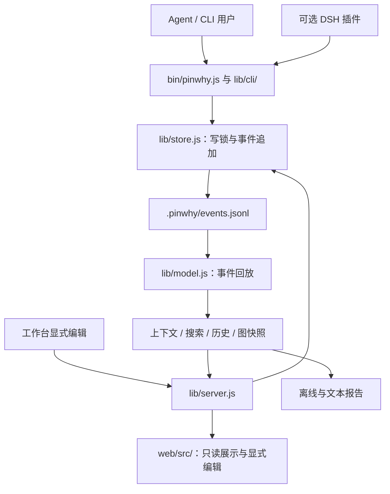

# 架构与维护边界

[文档目录](README.md) · [贡献指南](../CONTRIBUTING.md) · [工程原则](../AGENT.md) · [公开契约](CONTRACT.md)

本文描述当前开发代码（基于 Pinwhy `0.11.0`）的源码组织：CLI 支持代码、实时与离线图快照、实时推送与前端订阅、存储文件 I/O、批量输入准备、事务写入和版本包发布各有明确边界，开发验证脚本复用公共辅助实现。仓库内模块路径是实现细节；公开 SDK 只承诺 `pinwhy-core` 的根入口与导出的子路径，CLI 与 HTTP 接口由[公开契约](CONTRACT.md)定义。

## 数据如何流动

事件日志是唯一事实源。`state.json` 是可丢弃缓存；上下文包、图快照、历史、Digest 与导出都是投影。读取视角、布局、搜索和 URL 恢复不产生事件，也不替 Agent 选择下一步。节点与关系只在明确请求时写入，所有写入经过 store 的同一把事件写锁。

## 目录与责任

| 位置 | 维护职责与依赖边界 |
| --- | --- |
| `bin/pinwhy.js` | 唯一可执行入口；解析自身根目录、稳定 CLI 路径与版本，启动一次命令调用 |
| `lib/cli/invocation.js`、`lib/cli/run.js` | 单次调用的板目录、初始化策略、输出与错误边界；校验参数并分发命令，不持有跨调用共享状态 |
| `lib/cli/query-commands.js`、`mutation-commands.js`、`file-commands.js`、`integration-commands.js` | 分别管理查询投影、显式写入、导入导出文件和宿主/服务/版本接入；通过明确的调用上下文组装，领域逻辑留在原有内核 |
| `lib/cli/stdin.js` | 有界异步读取 stdin，保留大载荷与非阻塞管道语义 |
| `lib/cli/args.js` | CLI 参数解析与选项约束 |
| `lib/cli/help.js` | CLI 帮助文本 |
| `lib/cli/format.js` | 终端颜色与人类可读的行格式；不决定 JSON schema |
| `lib/contracts.js` | 纯常量：`OUTPUTS`、`WRITE_TARGETS`、`GRAPH_SCHEMA`；CLI 与投影共用，保持浏览器可用 |
| `lib/model.js`、`lib/semantics.js` | CLI、服务、浏览器共用的回放与语义；不引入 Node-only API |
| `lib/core.js` | SDK 根 facade，选择导出 model/store/context/search/history/backup 能力；复用同一份领域实现 |
| `lib/store.js` | SDK 公开存储入口与领域写入；集中管理写锁、请求缓冲与中断恢复，单条写入和 batch 共用执行函数。兼容的公开导出保留在此，内部文件操作直接依赖所属模块 |
| `lib/batch.js` | `batch` 的 JSONL 解析：字段白名单、类型与批内引用检查，错误带输入行号；不写事件 |
| `lib/storage/` | `layout.js` 定义板目录与路径；`board.js` 管理发现、初始化、配置和可丢弃状态缓存；`event-log.js` 读取、按检查点截取、回放和追加事件；`input.js` 统一字段长度、位置与批量输入准备。`file-lock.js` 管理跨进程锁与所有权；`event-file.js` 处理短读和有界内存尾行修复。依赖保持单向，读取失败不伪装为空日志 |
| `lib/context.js`、`lib/digest.js`、`lib/search.js`、`lib/history.js`、`lib/lint.js` | 由已记录的内容生成上下文、摘要、查询、追溯与提示；省略明确报告，不推断缺省维度 |
| `lib/snapshot.js` | Node 运行时中的 `buildGraphSnapshot`；实时 HTTP / SSE 与离线 HTML 共用图、身份与有效焦点投影，通过选项保留各自的可写性和活动详情边界 |
| `lib/server.js`、`lib/service.js` | loopback HTTP / SSE、读取路由、静态资产、服务端口与身份探测 |
| `lib/http/` | `request.js` 统一请求防护、JSON body 与错误响应；`write.js` 处理显式写入、署名、冲突与回执；`graph-stream.js` 只在有订阅者时轮询日志并推送完整快照，慢连接按 `drain` 只保留最新一份待发快照；均不管理服务生命周期 |
| `lib/export*.js` | 离线 HTML、文本报告、筛选数据与格式序列化；不新增事实源 |
| `lib/backup.js`、`lib/receipts.js` | 可校验备份恢复、从事件投影的写入回执 |
| `lib/setup.js`、`lib/hooks.js`、`lib/release.js` | 接入安装、可选 Claude Hook、稳定版本与 current 切换；开发仓库不直接替代日常安装 |
| `lib/doctor.js` | 只读聚合运行环境、构建身份、日志完整性、接入指向、服务注册与实际查看器状态；可分享报告隐藏本机路径 |
| `lib/services/` | Linux systemd 用户服务与 Windows 用户计划任务的原生适配，共用配置替换、健康校验失败回滚与恢复文件保留；macOS launchd 由 setup 保留现有生命周期 |
| `lib/release/` | `publication.js` 复制包文件、发布版本目录与 current 链接；强制替换失败时恢复原版本，回滚或清理失败时保留旧字节并报告恢复路径 |
| `lib/release/update.js` | CLI `release check` 与 HTTP `/api/update` 共用的按需版本检测；比较官方 main 包版本，带网络超时，不写安装或黑板状态 |
| `lib/build-info.js` | 固定运行进程的包内容指纹与来源；CLI、HTTP、SSE 和离线快照共用，不按请求重算 |
| `skills/pinwhy/` | 完整 Skill 的唯一发布源：入口、参考、方法、图标和宿主展示元信息一起分发 |
| `web/src/` | React 工作台，读取 API / SSE 或离线快照，保留显式编辑、冲突草稿和 Agent 阅读视角 |
| `public/` | Vite 从 `web/` 生成的分发资产，随根包提供给服务与离线导出 |
| `plugins/dsh-pinwhy/` | 独立依赖、版本与测试的可选宿主适配；根包不导入插件或 Host SDK |
| `packages/` | npm SDK 与官方 CLI 入口的包元数据和薄入口；SDK 实现从规范 `lib/` 源码生成暂存产物，不手工维护副本 |
| `scripts/pack-packages.mjs`、`scripts/verify-npm-packages.mjs` | 四包打包与隔离消费者安装验证；生成 `dist/npm/*.tgz` 与 `manifest.json`，属于发布工具而非运行时 |
| `scripts/`、`scripts/lib/` | 开发与验证入口；`environment.mjs` 隔离子进程的 PINWHY 环境，`npm.mjs` 统一 npm 入口查找与消费者配置隔离，`sarif-validator.mjs` 共用官方 SARIF schema 校验。打包器不依赖验证器入口；运行时不反向导入开发脚本 |
| `test/`、`test/fixtures/` | 根包行为测试、公开契约固定输出、合成事件与官方校验 schema；不进入运行时包 |

新功能按数据责任放进已有层。不要为内部模块改名保留转发文件；迁移所有内部调用方。公开接口需要兼容，内部实现路径不需要成为宿主依赖。

## 实时与离线快照

`lib/snapshot.js` 的内部入口 `buildGraphSnapshot(cwd, options)` 读取 store，统一节点、统计、各 Agent 摘要、焦点与可选构建身份；`writable` 默认 false，`includeActivityDetails`、`includeLocalPaths` 默认 true。它依赖 Node 存储，不是浏览器模块或宿主公开 API。

焦点只接受图中仍存在的节点：先取有效的事件元数据焦点，再取有效的缓存焦点，否则输出 null。`0.8.1` 修复了此前缓存 `focus` 指向不存在节点时，实时输出 null、离线 HTML 却保留失效 ID 的差异；有效节点与 Agent 身份的读取语义保持一致。

离线 HTML 显式关闭 `includeActivityDetails` 和 `includeLocalPaths`：活动只保留 `id`、`tool`、`status`、`at`、`linkedNodeIds`，排除原始 `input` / `output` / `summary`；构建身份保留内容指纹和来源类别，但裁剪 `origin.root` 本机路径，也不序列化 `meta.writable`。共享组装不把本地材料或编辑权限带入分享文件。

## 前端如何分工

`web/src/App.tsx` 组装面板、画布与工作台状态。`panels/EditPanel.tsx` 负责表单呈现和删除确认，`panels/use-node-forms.ts` 负责编辑基准、冲突草稿、创建后连边重试与已有节点连接。工作台数据、交互与视图控制沿 `web/src/workspace/` 分工：

- `selectors.ts`：纯快照索引、侧栏分组与筛选统计、Agent 阅读视角。
- `use-workspace-chrome.ts`：浏览器偏好、主题持久化、面板开关与键盘快捷键；不参与板数据写入。
- `use-workspace-data.ts`：派生数据和画布投影的 React memo 边界。
- `use-workspace-location.ts`：读取 URL 初始值，并同步 Agent / view / node 地址；不承担依赖快照的节点选择与布局恢复。
- `use-workspace-layout.ts`：共享节点与关系、异步 ELK 布局及取消、布局版本和拖动位置保留。
- `use-workspace-selection.ts`：深链解析、失效选择清理、隐藏节点揭示、选择事件与键盘导航。
- `use-workspace-viewport.ts`：首次框选、待聚焦节点、跟随和减少动态效果偏好。
- `use-workspace-presentation.ts`：选择、高亮和关系装饰，保留未改变卡片的对象身份。
- `use-workspace-scene.ts`：2D/3D 切换、触发器焦点归还、详情栏遮挡和图片导出。
- `use-workspace-feedback.ts`：新增记录提示、剪贴板反馈、通知及其计时器。
- `graph-stream.ts`：实时订阅控制器，管理 `/api/graph` 读取、`/events` 流、按请求开始排序和释放时中止请求；只接受顶层结构有效的图快照，无效数据保留上一份快照并显示离线，连接建立本身不算已同步。`use-graph-stream.ts` 只把它接入 React 状态。

现有 `graph.ts` 负责图投影，`presentation.ts` 负责记录的显示语义，`api.ts` 负责写请求，`panels/` 负责面板。浏览器共享模型不得通过新的间接 import 引入文件系统、进程或开发脚本。界面风格见[界面规范](../design/UI_SYSTEM.md)。

切换 Agent 只切换阅读视角。写请求仍由用户明确发起，只提交实际变更字段和对应基准；冲突保留草稿。实时工作台与离线 HTML 使用相同的图 schema 和身份语义，离线页面保留上述字段裁减，也不访问远端历史接口。

Topbar 从快照的可选 `meta.build` 展示版本与构建来源；旧快照不显示该控件，离线页面不额外请求版本接口。CLI 与 HTTP 的增量上下文复用同一次日志读取；多 Agent Digest 共用统计、节点排序、轨迹与检查点分组。

## 适配与发布边界

DSH 的 CLI 桥每次显式传 `--cwd`、`--agent`，写入另加 `--no-init`；兼容性、写入目标和资源位置均读取 `capabilities`。它不依赖内核的锁、缓存文件名或包安装目录结构。运行时声明 `features.resourcePaths: true` 和 `resources.cli` / `resources.skill` 绝对路径，插件据此读取完整 Skill，也支持 `pinwhy-cli` 薄入口与稳定 CLI 符号链接；详见[插件说明](../plugins/dsh-pinwhy/README.md)。

根 npm 包 `pinwhy@0.11.0` 按 `package.json.files` 分发 `bin/`、`lib/`、`skills/`、`public/`、首页与根 `LICENSE`，是零运行时依赖的完整产品。前端及导出消费端验证依赖均为开发依赖；安装后的 Node 18 CLI 使用已构建产物。

`pinwhy-core@0.11.0` 是 Node ≥ 18、零依赖 SDK。公开导出为 `.`、`/model`、`/store`、`/context`、`/search`、`/history`、`/backup`、`/contracts`；其中 `/model` 保持浏览器安全。SDK 根 facade 只选择领域函数，不拉入 CLI、HTTP 服务、Hook、安装器或宿主适配。打包时从唯一维护的 `lib/` 生成 SDK 暂存文件；修改源实现后重新打包，不直接编辑生成副本，也不为 SDK 建立第二套存储或回放实现。

`pinwhy-cli@0.11.0` 精确依赖 `pinwhy@0.11.0`，薄入口执行根产品的真实 `bin/pinwhy.js`。两种全局安装都提供 `pinwhy` 命令，用户选择其中一种。`dsh-pinwhy@0.3.0` 仍为可选适配器，有自己的宿主 Node 要求与 DSH rc.2 兼容门禁，根包不拉入 Host SDK。

安装 npm 包或导入 SDK 不启用 Hook、注册服务或迁移真实数据；这些动作由显式命令执行。现有源码 `release install`、不可变版本和 `current` 继续支持。通过该流程安装的日常启动器、Skill、Hook 与常驻服务指向独立安装的 `current`。开发时只写独立合成演示板；[本地启动与验证](../CONTRIBUTING.md#local-development)列出实际命令。

Windows 启动器使用原生 `.cmd`，Claude Hook 显式使用 Git Bash；POSIX 启动器与 Hook 对可执行路径作 shell 转义。Windows current 使用无需管理员权限的 junction，替换失败恢复旧指向，成功后的清理失败另行报告；POSIX 继续原子替换符号链接。

开发验证子进程通过 `scripts/lib/environment.mjs` 的 `isolatedPinwhyEnv` 去掉继承的全部 `PINWHY_*`，再显式加入该次验证的覆盖值，避免误选真实项目。`scripts/lib/sarif-validator.mjs` 读取测试目录中的固定 OASIS schema，以 Ajv 校验真实导出结果；Ajv、schema fixture 与这两个脚本都留在开发边界，运行时 SARIF 导出不依赖它们。

## 改动在哪里验证

| 变更范围 | 主要行为证据 |
| --- | --- |
| CLI 参数、输出与 schema | `test/pinwhy.test.js`、`test/contract-output.test.js`、`test/write-contract.test.js`、`test/node-json.test.js`；固定输出与 capabilities 同步 |
| 批量写入 | `test/batch.test.js`：批内引用与作者、不移动游标、任一行出错整批不写、request-id 重试与中途中断后的补齐、上限与截断 |
| 事件、写锁、身份、恢复 | `test/store-io.test.js` 的异常、短读与所有权回归，及 `test/recovery.test.js`、`test/receipts.test.js`、`test/backup.test.js`、`test/iteration.test.js` |
| 上下文预算与历史 | `test/context-*.test.js`、`test/history.test.js`；`npm run evaluate:recovery` 验证合成投影，不替代真实模型恢复试验 |
| 服务写入、历史与回执 | `test/api-receipts.test.js`、`test/input-integrity-api.test.js`；可选 `npm run verify:api` 需要 Postman CLI |
| 视角、筛选、显示与图布局 | `test/frontend.test.js`、`test/canvas.test.js`、`test/web-completeness.test.js`；纯模块测试不等于完整浏览器交互验收 |
| 实时 / 离线图快照一致性 | `test/snapshot.test.js`：通过真实 HTTP 与导出的 HTML 检查失效缓存焦点处理，并保留离线活动详情与可写标记的裁减边界 |
| 实时推送与订阅 | `test/graph-stream-delivery.test.js` 覆盖慢连接合并、空闲后加入和已断开读者；`test/graph-stream.test.js` 覆盖前端排序、无效快照保留、释放中止和离线导出不发请求 |
| HTML、Markdown、Mermaid、SARIF | `test/export*.test.js`，再用 `npm run verify:exports` 做 Chromium 消费端与官方 SARIF schema 验证 |
| 包边界、版本发布与 Node 运行时 | `test/packaging.test.js`、`test/release.test.js` 的发布失败回滚与清理、`npm run verify:package`；真实 tarball 的干净消费者安装 |
| Skill、可选方法、公开内容 | `test/skill.test.js`、`test/methods.test.js`、`test/publication.test.js`、`npm run check:publish` |
| 文档路径、图片与锚点 | `test/docs.test.js`、`npm run check:docs`；本地解析公开 Markdown，不探测外部站点 |
| DSH 插件 | 插件自己的 `test/` 与 `npm run check`；真实 Host、设置页、profile 与模型检查按[插件文档](../plugins/dsh-pinwhy/README.md#测试)分别执行 |

这些是验证入口与职责，不是本次执行记录。跨平台与运行时矩阵的覆盖、实际命令和未覆盖环境见 [CI 说明](ci.md)；性能测量见[性能基线](performance.md)。
